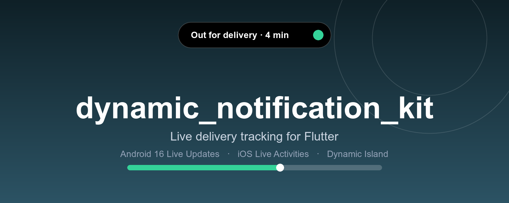
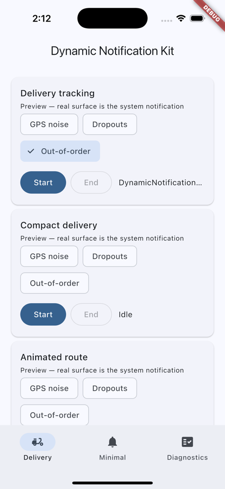
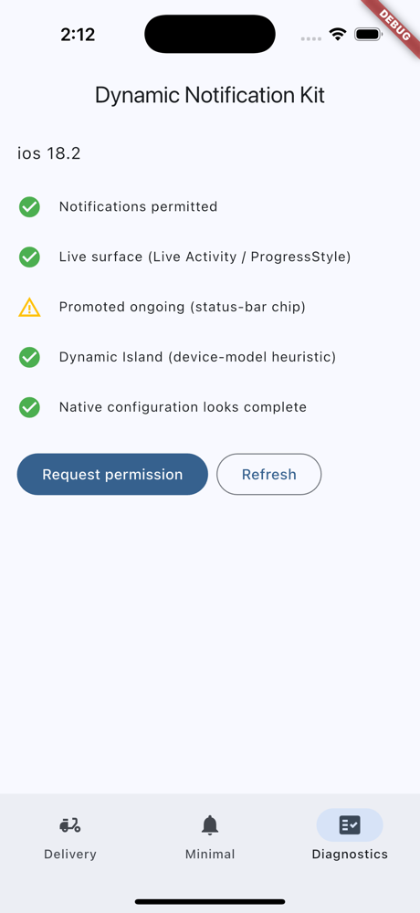

<p align="center">
  
</p>

<p align="center">
  <a href="https://pub.dev/packages/dynamic_notification_kit"></a>
  <a href="https://pub.dev/packages/dynamic_notification_kit/score"></a>
  <a href="https://github.com/bijithintersmart/dynamic_notification_kit/actions/workflows/ci.yml"></a>
  
  <a href="LICENSE"></a>
</p>

<p align="center">
  <b>Animated delivery tracking</b> and <b>minimal ongoing notifications</b> for Flutter.<br>
  One API. Android 16 Live Updates, iOS Live Activities and Dynamic Island.
</p>

<p align="center">
  <a href="#-features">Features</a> ·
  <a href="#-installation">Install</a> ·
  <a href="#%EF%B8%8F-setup-one-command">Setup</a> ·
  <a href="#-usage">Usage</a> ·
  <a href="#-templates">Templates</a> ·
  <a href="#%EF%B8%8F-limitations">Limitations</a>
</p>

---

<p align="center">
  
  &nbsp;&nbsp;&nbsp;
  
</p>

## ✨ Features

| | |
| --- | --- |
| 🛵 **Delivery tracking** | Progress, vehicle icon, ETA and route, plus driver-approaching and completed states |
| 🔕 **Minimal mode** | Small ongoing notification with a chronometer or progress |
| 📍 **GPS-aware controller** | Outlier rejection, smoothing, monotonic route projection, throttling and retry with backoff |
| 🏝️ **Dynamic Island** | Live Activities on iOS 16.2+, falling back to a local notification |
| 🤖 **Android 16 Live Updates** | `Notification.ProgressStyle` with a custom-layout fallback below API 36 |
| ⚙️ **One-command setup** | Patches the manifest, `Info.plist`, Podfile and the Xcode widget extension |

## 📱 Platform support

| | Android 16 (API 36) | Android < 16 | iOS 16.2+ | iOS < 16.2 / Live Activities off |
| --- | --- | --- | --- | --- |
| **Delivery tracking** | `Notification.ProgressStyle` + vehicle tracker icon, Live Update chip (ETA) when permitted | Ongoing notification, custom layout with drawn route + vehicle | Live Activity: lock screen + Dynamic Island | Local notification (replaced in place) |
| **Minimal mode** | Small icon + short text, optional chronometer / progress, chip text only as a Live Update | Same, without chip | Live Activity (compact) | Local notification |

> Dynamic Island detection is a **device-model heuristic** and is reported as such.

## 📦 Installation

```sh
flutter pub add dynamic_notification_kit
```

## ⚙️ Setup (one command)

```sh
dart run dynamic_notification_kit:setup          # android + ios + widget extension
```

Flags: `--android --ios --widget --update --dry-run --check --revert --frequent-updates --project <dir>`.

The setup is idempotent, writes `.bak` backups, and `--check` exits non-zero if configuration is missing (handy in CI). It patches:

- 🤖 the Android manifest and `compileSdk`
- 🍎 `Info.plist` (`NSSupportsLiveActivities`) and the Podfile
- 🧩 the Xcode widget extension (needs Ruby + `xcodeproj`, included with CocoaPods)

If it can't patch something, it prints manual steps. You must still **set a signing team** for the extension target.

<details>
<summary><b>Customising or updating the iOS widget</b></summary>

The Live Activity UI is plain SwiftUI in `ios/DeliveryLiveActivity/`, so edit it freely. After upgrading the package, run `dart run dynamic_notification_kit:setup --widget --update` to pull in the latest templates (your edited copy is kept as `*.user.bak`). Call `DynamicNotification.openSettings()` to send users to the OS page for Live Activities / Live Updates.

</details>

> **iOS note:** Live Activities and the Dynamic Island only appear when the app is in the background (or the phone is locked), never over the foreground app.

## 🚀 Usage

```dart
final c = await DynamicNotification.startDelivery(
  id: 'order-42',
  template: DeliveryTrackingTemplate(route: route),
  state: DeliveryState(
    progress: 0,
    vehicle: DeliveryVehicle.scooter,
    eta: DateTime.now().add(const Duration(minutes: 12)),
  ),
);

await c.updateLocation(lat, lng, accuracyMeters: 8, speedMps: 6); // or c.update(progress: .4)
await c.complete();
await c.end();
```

Minimal mode:

```dart
DynamicNotification.start(DynamicNotificationRequest(mode: minimal, compact: ...));
```

The controller handles GPS outlier rejection and smoothing, monotonic route projection, out-of-order drops, dedup, throttling with trailing coalescing, post-completion lock, and retry with backoff. Dart sends `from` / `to` / `animationMs`; the platform renders the transition, so there is no high-frequency redraw loop. Errors are `DynamicNotificationException` with a `DynamicNotificationErrorCode`.

## 🎨 Templates

| Template | Use it for |
| --- | --- |
| `DeliveryTrackingTemplate` | Full tracking with route, vehicle and ETA |
| `CompactDeliveryTemplate` | Condensed single-line delivery status |
| `AnimatedRouteTemplate` | Route drawn and animated between updates |
| `DriverApproachingTemplate` | "Your driver is almost here" |
| `DeliveryCompletedTemplate` | Final delivered state |

## ⚠️ Limitations

- Android 16 Live Update promotion is requested via the `android.requestPromotedOngoing` extra and is still subject to system rules and user settings. Check `getCapabilities()`.
- Android has no custom status-bar text outside Live Updates.
- iOS Live Activities are budgeted by the OS; frequent updates need `--frequent-updates`. Push-to-update tokens are emitted on the events stream; server push is out of scope.
- `AnimatedRouteTemplate` animation on iOS relies on SwiftUI state transitions (system-controlled).
- Failure injection is not part of the example simulator.

## 📚 More

- 📱 Example app: [`example/`](example) with Delivery, Minimal and Diagnostics tabs
- ✅ Device validation matrix: [`doc/validation.md`](doc/validation.md)
- 📖 [API reference](https://pub.dev/documentation/dynamic_notification_kit/latest/)

## 🤝 Contributing

Issues and pull requests are welcome on [GitHub](https://github.com/bijithintersmart/dynamic_notification_kit/issues). Please run `dart format .`, `flutter analyze` and `flutter test` before opening a PR; CI enforces them.

## 📄 License

MIT © Intersmart
